# Transição de votos para presidente, 1º → 2º turno de 2026

Para onde foram, no 2º turno, os eleitores de cada grupo do 1º turno — Lula, Flávio Bolsonaro, outros
candidatos, brancos, nulos e abstenção — estimado por inferência ecológica a partir dos resultados oficiais
do TSE. Todo o código, os dados derivados e os resultados estão neste repositório para que qualquer pessoa
possa replicar e validar.

## Resumo

- **Lula ganhou 10,38 mi de votos entre os turnos; Flávio, 3,72 mi.**
  Os outros candidatos somavam 9,32 mi no 1º turno — menos que o ganho do Lula sozinho.
- **Origem do ganho do Lula** (modelo principal, sobre seções eleitorais): outros candidatos
  3,95 mi, abstenção do 1º turno 3,17 mi, nulos 2,19 mi, brancos
  1,59 mi; perdas de 0,60 mi (sobretudo eleitores dele que se abstiveram no 2º turno).
- **Eleitores de outros candidatos** se dividiram: 42,4% para o Lula,
  38,1% para o Flávio e 19,6% votaram branco, nulo ou se
  abstiveram. A divisão varia muito por estado: foram mais para o Flávio em AC, DF, GO, MS, PR, RR, RS e SC (8 de 27 estados); nos demais, mais para
  o Lula.
- **Brancos e nulos do 1º turno** foram em grande parte para o Lula
  (69,2% e 59,6%); o Flávio recebeu cerca
  de 2% de cada grupo. Cerca de um quarto a um terço repetiu o voto branco ou nulo.
- **Abstenção do 1º turno:** 86,8% continuou se abstendo;
  9,5% votou no Lula e 2,3% no Flávio.
- **A virada foi decidida pela mobilização.** O Flávio terminou o 1º turno 2,22 mi à frente e perdeu o 2º
  por 4,43 mi. Da virada, 6,05 mi vêm de quem não tinha votado em candidato no 1º turno (abstenção,
  brancos e nulos, saldo Lula − Flávio) e só 0,40 mi dos eleitores de outros candidatos. A conclusão vale
  também no modelo sobre municípios (ver [Conclusões e hipóteses](#conclusões-e-hipóteses)).
- **Os eleitores novos seguiram a inclinação política do lugar:** onde o Flávio era fraco, quase todos foram para o
  Lula; onde era forte, ele levou a maior parte. Houve mais eleitores novos onde o Lula era forte (ver
  [Eleitores novos](#eleitores-novos)).
- **O que é robusto:** estimando sobre municípios em vez de seções, a direção de todos os fluxos é a mesma.
  Muda o tamanho de alguns: sobre municípios, Outros → Lula sobe para 52,6%
  e Abstenção → Lula cai para 6,7%. O modelo sobre seções é o mais
  confiável (ver [Comparação](#comparação-entre-modelos)).
- **Testes de integridade estatística** (impressão digital, seções extremas, modelo de urna, votos fixos por urna, logs de biometria, Benford, Poisson e efeitos fixos por zona, calibrados com 2022) não mostram as marcas de manipulação que detectariam; a inserção de votos sem eleitor real compatível com os logs é de no máximo 0,47% do eleitorado (ver [Testes de integridade](#testes-de-integridade-estatística)).
- **Roraima, Amapá e Acre** têm pouca informação para estimar a matriz; as estimativas de Roraima, em especial,
  não devem ser interpretadas (ver [Estados com pouca informação](#estados-com-pouca-informação-rr-ap-e-ac)).
  Juntos têm 1,0% dos votos em outros candidatos, o que pesa pouco no total do Brasil.

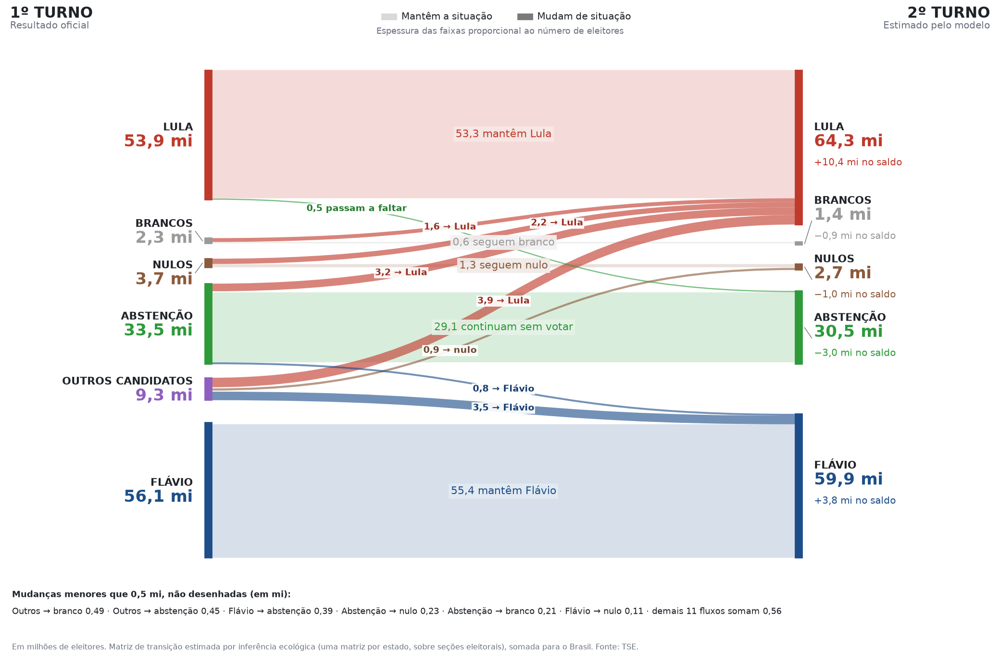

## Dados

| Nível | Fonte | Uso |
|---|---|---|
| Seção eleitoral | Dados abertos do TSE: `votacao_secao_2026_BR.zip` e `detalhe_votacao_secao_2026.zip` | modelo principal |
| Município | Site de resultados do TSE (`resultados.tse.jus.br`), eleições 6257 (1º turno) e 6258 (2º turno) | comparação |

- Base por seção: 499.248 seções, todas presentes nos dois turnos, nenhuma anulada.
  Eleitorado de 158.745.502.
- Os totais de Lula, Flávio, brancos, abstenção e eleitorado batem voto a voto entre as duas fontes e com o
  resultado oficial (Lula 64.256.232 e Flávio 59.826.041 no 2º turno). A única diferença são
  5.246 votos do 1º turno que o site de resultados conta como nulos e o
  arquivo por seção conta em outros candidatos (provavelmente votos em candidaturas indeferidas): 0,06% de Outros.
- Nulos incluem os votos anulados em apuração separada. Em 41 seções os grupos diferem do eleitorado em até
  29 eleitores, nas duas fontes.

## Metodologia

- Para cada seção (ou município), a composição do eleitorado no 2º turno é modelada como a composição do 1º turno
  multiplicada por uma matriz de transição P (6 × 5): cada linha soma 100% e cada entrada fica entre 0 e 100%.
- **Uma matriz por estado**, estimada por mínimos quadrados com essas restrições, ponderando cada observação pelo
  eleitorado. Cada matriz estadual é puxada para a matriz da sua região com peso equivalente a 5 observações
  médias; sobre seções esse puxão é desprezível (ver [Sensibilidade](#sensibilidade)).
- **Brasil:** soma dos fluxos estimados em cada estado e no exterior, o que equivale a ponderar cada matriz pelo
  eleitorado de cada grupo do 1º turno naquele estado.
- **Incerteza:** bootstrap com 200 reamostragens. No modelo sobre seções, reamostram-se grupos inteiros de
  zona eleitoral × município dentro de cada estado, porque seções da mesma zona votam de forma parecida;
  reamostrar seções soltas daria intervalos estreitos demais. Intervalos de 90%.
- Para comparação, o mesmo modelo foi estimado sobre municípios, e uma versão com uma matriz por região.

## Resultados — modelo principal (sobre seções)

### Matriz nacional

% de cada grupo do 1º turno, intervalo de 90% entre colchetes, e eleitores estimados.

| 1º turno ↓ / 2º turno → | Lula | Flávio | Brancos | Nulos | Abstenção |
|---|---|---|---|---|---|
| **Lula** (53,88 mi) | 98,9% [98,8–99,0]<br>53,28 mi | 0,0% [0,0–0,0]<br>≈0 | 0,0% [0,0–0,0]<br>11 mil | 0,1% [0,1–0,1]<br>68 mil | 1,0% [0,9–1,1]<br>0,52 mi |
| **Flávio** (56,10 mi) | 0,2% [0,1–0,2]<br>87 mil | 98,8% [98,7–98,9]<br>55,43 mi | 0,2% [0,1–0,2]<br>91 mil | 0,2% [0,2–0,2]<br>0,11 mi | 0,7% [0,6–0,8]<br>0,39 mi |
| **Outros** (9,32 mi) | 42,4% [41,7–43,0]<br>3,95 mi | 38,1% [37,5–38,5]<br>3,55 mi | 5,2% [5,1–5,4]<br>0,49 mi | 9,5% [9,3–9,7]<br>0,89 mi | 4,8% [4,5–5,2]<br>0,45 mi |
| **Brancos** (2,30 mi) | 69,2% [67,7–70,2]<br>1,59 mi | 1,9% [1,6–2,5]<br>43 mil | 24,3% [23,7–24,7]<br>0,56 mi | 3,0% [2,6–3,3]<br>69 mil | 1,6% [0,8–2,9]<br>38 mil |
| **Nulos** (3,67 mi) | 59,6% [58,5–60,4]<br>2,19 mi | 1,9% [1,6–2,8]<br>71 mil | 1,4% [1,1–1,7]<br>51 mil | 36,4% [35,7–36,8]<br>1,33 mi | 0,8% [0,4–1,1]<br>28 mil |
| **Abstenção** (33,47 mi) | 9,5% [9,2–9,8]<br>3,17 mi | 2,3% [2,2–2,5]<br>0,79 mi | 0,6% [0,6–0,7]<br>0,21 mi | 0,7% [0,7–0,8]<br>0,23 mi | 86,8% [86,5–87,1]<br>29,07 mi |

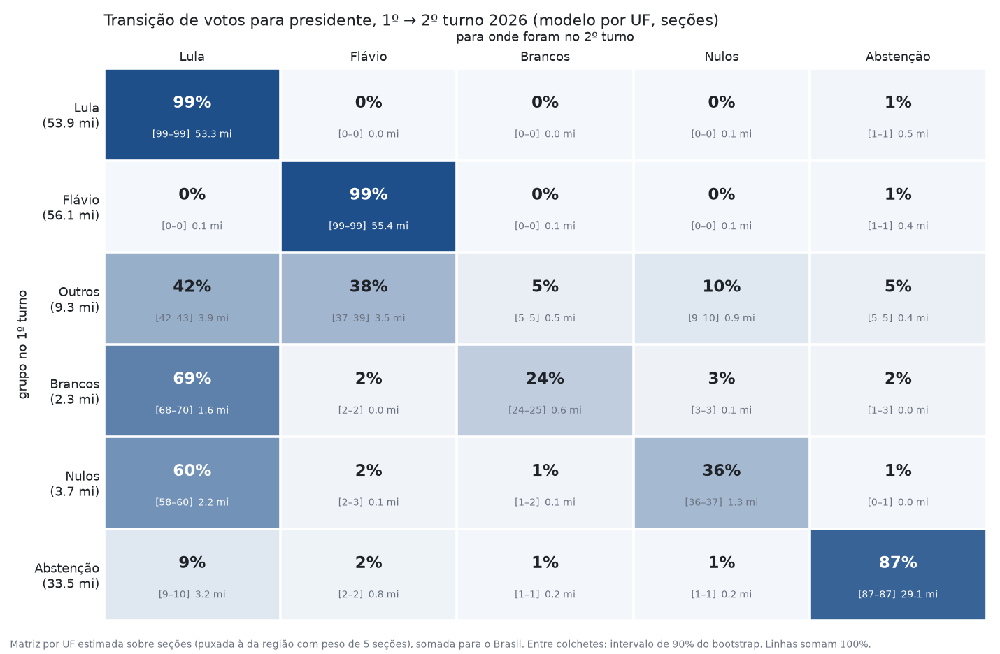

### De onde veio o ganho do Lula

| Origem no 1º turno | Seções (principal) | Municípios, por estado | Municípios, por região |
|---|---:|---:|---:|
| Outros | 3,95 mi | 4,90 mi | 4,52 mi |
| Abstenção | 3,17 mi | 2,23 mi | 2,29 mi |
| Nulos | 2,19 mi | 2,14 mi | 2,32 mi |
| Brancos | 1,59 mi | 1,49 mi | 1,63 mi |
| Flávio | 87 mil | 54 mil | ≈0 |
| Perdas (eleitores do Lula no 1º turno que não votaram nele no 2º) | −0,60 mi | −0,45 mi | −0,37 mi |
| **Ganho líquido** | **10,38 mi** | **10,37 mi** | **10,39 mi** |

### Conferência: 2º turno estimado × real

| Grupo | Real | Estimado (seções) | Estimado (municípios) |
|---|---:|---:|---:|
| Lula | 64.256.232 | 64.263.643 | 64.246.065 |
| Flávio | 59.826.041 | 59.881.454 | 59.876.257 |
| Brancos | 1.430.496 | 1.411.119 | 1.406.152 |
| Nulos | 2.723.305 | 2.699.248 | 2.692.890 |
| Abstenção | 30.509.005 | 30.489.616 | 30.523.715 |

### Por estado

Uma tabela e um gráfico por grupo do 1º turno, com o destino no 2º turno: Lula, Flávio ou
Branco/Nulo/Abstenção (somados). As três colunas somam 100% em cada estado. Estados agrupados por região e em
ordem alfabética. ⚠ = pouca informação (ver seção própria). O intervalo de Branco/Nulo/Abstenção vem das
repetições do bootstrap, não da soma dos intervalos de cada destino.

### Outros (9,32 mi no 1º turno)

| Região | UF | → Lula | → Flávio | → Branco/Nulo/Abstenção |
|---|---|---:|---:|---:|
| **Nordeste** | AL | 55% [48–60] | 34% [29–39] | 11% [6–17] |
|  | BA | 58% [54–62] | 29% [26–32] | 12% [11–14] |
|  | CE | 52% [48–55] | 34% [31–38] | 14% [13–16] |
|  | MA | 60% [56–63] | 22% [17–26] | 18% [15–24] |
|  | PB | 45% [41–47] | 34% [32–36] | 21% [18–25] |
|  | PE | 43% [39–47] | 31% [29–33] | 26% [23–29] |
|  | PI | 61% [57–65] | 25% [22–28] | 14% [11–19] |
|  | RN | 51% [46–53] | 38% [35–42] | 11% [9–16] |
|  | SE | 56% [51–60] | 28% [24–30] | 16% [13–22] |
| **Norte** | AC ⚠ | 41% [35–48] | 59% [52–65] | 0% [0–0] |
|  | AM | 60% [56–65] | 34% [28–39] | 6% [2–10] |
|  | AP ⚠ | 64% [58–69] | 36% [31–42] | 0% [0–3] |
|  | PA | 68% [65–72] | 27% [24–30] | 4% [2–7] |
|  | RO | 53% [45–57] | 22% [18–29] | 26% [21–29] |
|  | RR ⚠ | 30% [22–40] | 70% [0–76] | 0% [0–71] |
|  | TO | 56% [47–58] | 35% [19–43] | 9% [4–33] |
| **Centro-Oeste** | DF | 37% [34–41] | 43% [39–45] | 20% [18–23] |
|  | GO | 36% [34–38] | 48% [47–50] | 16% [14–17] |
|  | MS | 28% [21–33] | 49% [45–53] | 23% [18–30] |
|  | MT | 46% [42–51] | 29% [27–32] | 25% [19–28] |
| **Sudeste** | ES | 48% [45–51] | 36% [33–39] | 16% [13–19] |
|  | MG | 46% [44–48] | 36% [35–38] | 18% [16–19] |
|  | RJ | 45% [43–47] | 40% [37–42] | 15% [14–18] |
|  | SP | 38% [37–39] | 37% [36–38] | 25% [24–26] |
| **Sul** | PR | 29% [28–31] | 46% [45–47] | 25% [24–26] |
|  | RS | 27% [25–29] | 50% [49–51] | 23% [21–24] |
|  | SC | 29% [27–32] | 46% [44–49] | 24% [23–26] |
| **Exterior** | Exterior | 61% [44–78] | 31% [19–43] | 7% [0–18] |
| **BRASIL** | | **42,4%** [41,7–43,0] · 3,95 mi | **38,1%** [37,5–38,5] · 3,55 mi | **19,6%** [19,1–20,2] · 1,82 mi |

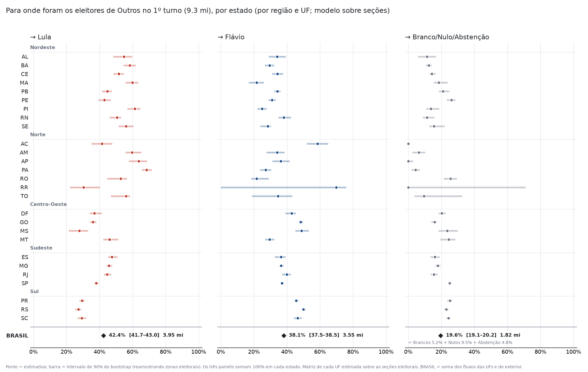

### Brancos (2,30 mi no 1º turno)

| Região | UF | → Lula | → Flávio | → Branco/Nulo/Abstenção |
|---|---|---:|---:|---:|
| **Nordeste** | AL | 57% [42–66] | 0% [0–16] | 43% [33–53] |
|  | BA | 83% [79–87] | 0% [0–0] | 17% [13–21] |
|  | CE | 71% [66–75] | 0% [0–1] | 29% [25–34] |
|  | MA | 76% [70–82] | 0% [0–0] | 24% [18–30] |
|  | PB | 72% [67–76] | 0% [0–3] | 28% [23–33] |
|  | PE | 69% [64–73] | 3% [0–7] | 29% [26–31] |
|  | PI | 82% [74–88] | 0% [0–6] | 18% [12–23] |
|  | RN | 70% [63–74] | 0% [0–4] | 30% [26–35] |
|  | SE | 68% [57–72] | 1% [0–13] | 32% [27–37] |
| **Norte** | AC ⚠ | 50% [39–62] | 50% [36–61] | 0% [0–2] |
|  | AM | 59% [47–69] | 25% [11–40] | 16% [7–26] |
|  | AP ⚠ | 66% [48–79] | 34% [17–52] | 0% [0–11] |
|  | PA | 88% [82–93] | 5% [1–9] | 7% [3–12] |
|  | RO | 51% [42–56] | 15% [4–27] | 34% [27–44] |
|  | RR ⚠ | 30% [0–46] | 70% [4–88] | 0% [0–90] |
|  | TO | 65% [57–73] | 0% [0–0] | 35% [27–43] |
| **Centro-Oeste** | DF | 65% [58–69] | 0% [0–0] | 35% [31–42] |
|  | GO | 81% [73–86] | 0% [0–1] | 19% [14–26] |
|  | MS | 57% [41–66] | 9% [0–16] | 34% [26–52] |
|  | MT | 79% [71–83] | 0% [0–5] | 21% [17–26] |
| **Sudeste** | ES | 45% [40–50] | 0% [0–0] | 55% [50–60] |
|  | MG | 70% [68–72] | 0% [0–0] | 30% [28–32] |
|  | RJ | 64% [57–70] | 0% [0–0] | 36% [30–43] |
|  | SP | 73% [70–75] | 0% [0–0] | 27% [25–30] |
| **Sul** | PR | 60% [56–65] | 4% [0–8] | 36% [31–39] |
|  | RS | 57% [53–61] | 8% [5–11] | 35% [33–39] |
|  | SC | 60% [52–66] | 5% [0–12] | 35% [32–40] |
| **Exterior** | Exterior | 0% [0–0] | 42% [14–66] | 58% [34–86] |
| **BRASIL** | | **69,2%** [67,7–70,2] · 1,59 mi | **1,9%** [1,6–2,5] · 43 mil | **28,9%** [28,0–30,2] · 0,67 mi |

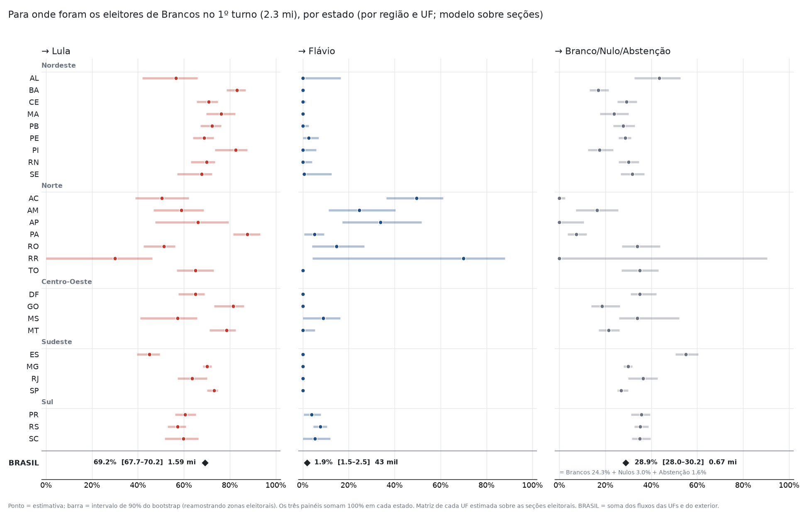

### Nulos (3,67 mi no 1º turno)

| Região | UF | → Lula | → Flávio | → Branco/Nulo/Abstenção |
|---|---|---:|---:|---:|
| **Nordeste** | AL | 70% [64–76] | 0% [0–0] | 30% [23–36] |
|  | BA | 61% [58–64] | 0% [0–3] | 39% [36–41] |
|  | CE | 70% [65–73] | 2% [0–7] | 28% [26–30] |
|  | MA | 85% [83–88] | 0% [0–0] | 15% [12–17] |
|  | PB | 79% [77–81] | 0% [0–0] | 21% [19–23] |
|  | PE | 75% [73–77] | 0% [0–0] | 25% [23–27] |
|  | PI | 69% [66–72] | 1% [0–5] | 29% [26–32] |
|  | RN | 59% [57–62] | 0% [0–0] | 41% [38–43] |
|  | SE | 70% [64–74] | 1% [0–9] | 28% [25–31] |
| **Norte** | AC ⚠ | 30% [14–44] | 1% [0–27] | 69% [42–84] |
|  | AM | 42% [33–48] | 0% [0–0] | 58% [52–67] |
|  | AP ⚠ | 85% [64–100] | 0% [0–0] | 15% [0–36] |
|  | PA | 67% [60–72] | 0% [0–0] | 33% [28–40] |
|  | RO | 53% [43–64] | 0% [0–7] | 47% [36–56] |
|  | RR ⚠ | 5% [0–41] | 0% [0–0] | 95% [59–100] |
|  | TO | 46% [42–51] | 0% [0–0] | 54% [49–58] |
| **Centro-Oeste** | DF | 51% [44–56] | 2% [0–10] | 46% [43–49] |
|  | GO | 57% [52–62] | 11% [7–15] | 32% [29–35] |
|  | MS | 55% [48–61] | 8% [2–13] | 37% [32–45] |
|  | MT | 51% [45–59] | 0% [0–5] | 49% [41–54] |
| **Sudeste** | ES | 29% [24–33] | 6% [1–12] | 65% [61–69] |
|  | MG | 58% [55–60] | 0% [0–2] | 42% [40–44] |
|  | RJ | 52% [48–55] | 5% [0–11] | 44% [39–47] |
|  | SP | 57% [54–59] | 0% [0–0] | 43% [41–46] |
| **Sul** | PR | 49% [45–52] | 12% [9–16] | 39% [37–41] |
|  | RS | 57% [52–61] | 7% [4–12] | 36% [34–39] |
|  | SC | 41% [35–46] | 11% [6–16] | 49% [46–51] |
| **Exterior** | Exterior | 0% [0–11] | 0% [0–19] | 100% [76–100] |
| **BRASIL** | | **59,6%** [58,5–60,4] · 2,19 mi | **1,9%** [1,6–2,8] · 71 mil | **38,5%** [37,6–39,2] · 1,41 mi |

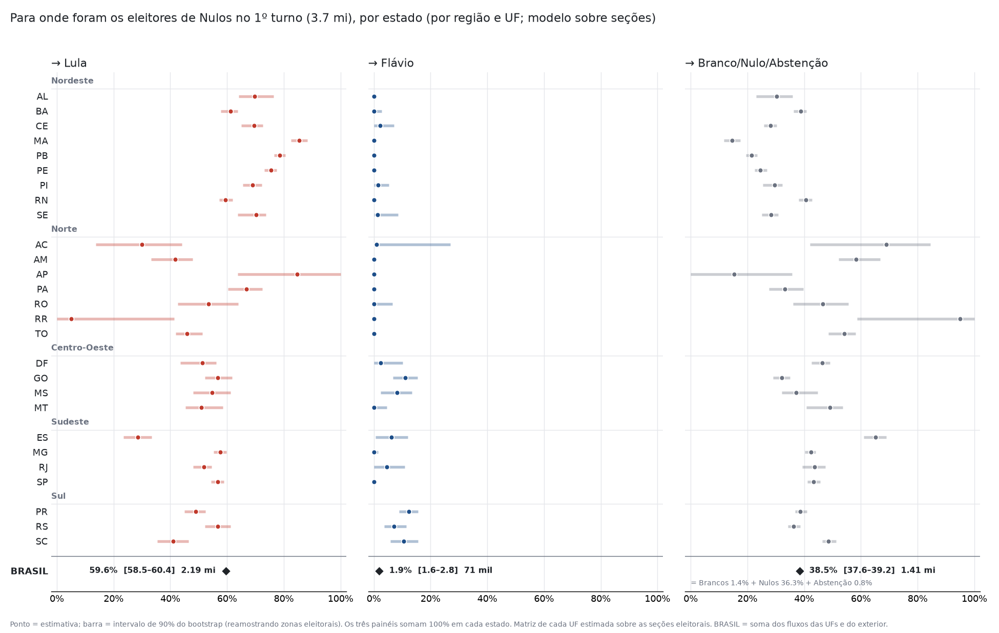

### Abstenção (33,47 mi no 1º turno)

| Região | UF | → Lula | → Flávio | → Branco/Nulo/Abstenção |
|---|---|---:|---:|---:|
| **Nordeste** | AL | 12% [8–16] | 0% [0–0] | 88% [84–92] |
|  | BA | 12% [11–14] | 3% [3–4] | 85% [83–86] |
|  | CE | 14% [13–16] | 0% [0–0] | 86% [84–87] |
|  | MA | 9% [7–11] | 0% [0–0] | 91% [89–93] |
|  | PB | 13% [11–14] | 0% [0–0] | 87% [86–89] |
|  | PE | 15% [15–17] | 0% [0–0] | 85% [83–85] |
|  | PI | 6% [4–8] | 0% [0–0] | 94% [92–96] |
|  | RN | 19% [16–20] | 0% [0–0] | 81% [80–84] |
|  | SE | 16% [14–18] | 0% [0–0] | 84% [82–86] |
| **Norte** | AC ⚠ | 2% [0–8] | 0% [0–0] | 98% [92–100] |
|  | AM | 0% [0–0] | 0% [0–0] | 100% [100–100] |
|  | AP ⚠ | 0% [0–0] | 0% [0–0] | 100% [100–100] |
|  | PA | 3% [1–4] | 0% [0–0] | 97% [96–99] |
|  | RO | 1% [0–3] | 2% [1–4] | 97% [94–98] |
|  | RR ⚠ | 0% [0–4] | 0% [0–0] | 100% [96–100] |
|  | TO | 2% [0–4] | 0% [0–0] | 98% [96–100] |
| **Centro-Oeste** | DF | 13% [12–15] | 1% [0–3] | 86% [84–86] |
|  | GO | 8% [7–9] | 0% [0–0] | 92% [91–93] |
|  | MS | 12% [10–14] | 2% [1–4] | 86% [83–88] |
|  | MT | 5% [4–6] | 3% [2–4] | 92% [91–93] |
| **Sudeste** | ES | 6% [6–7] | 1% [0–2] | 93% [92–94] |
|  | MG | 8% [7–8] | 3% [2–3] | 90% [89–90] |
|  | RJ | 9% [9–10] | 5% [5–6] | 86% [85–87] |
|  | SP | 9% [9–10] | 4% [4–4] | 87% [86–87] |
| **Sul** | PR | 11% [11–12] | 3% [3–4] | 85% [85–86] |
|  | RS | 12% [12–13] | 0% [0–0] | 88% [87–88] |
|  | SC | 10% [9–11] | 3% [2–4] | 87% [86–87] |
| **Exterior** | Exterior | 4% [3–5] | 3% [2–3] | 93% [93–94] |
| **BRASIL** | | **9,5%** [9,2–9,8] · 3,17 mi | **2,3%** [2,2–2,5] · 0,79 mi | **88,2%** [87,9–88,4] · 29,51 mi |

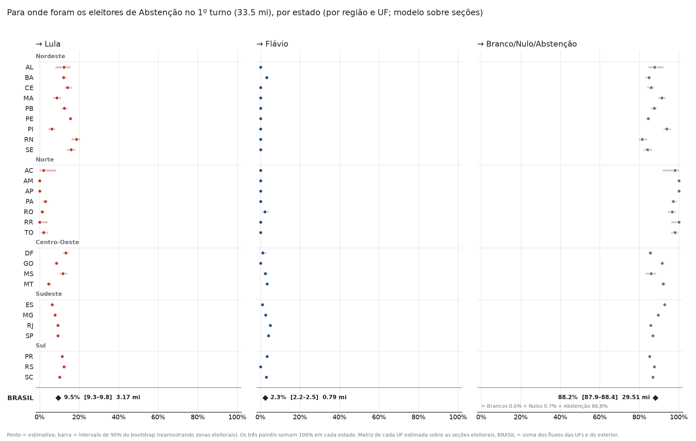


## Comparação entre modelos

Brasil, % de cada grupo do 1º turno.

| Fluxo | Seções, por estado (principal) | Municípios, por estado | Municípios, por região |
|---|---|---|---|
| Outros → Lula | 42,4% [41,7–43,0] | 52,6% [49,7–55,1] | 48,5% |
| Outros → Flávio | 38,1% [37,5–38,5] | 35,8% [33,1–37,4] | 40,3% |
| Outros → Brancos | 5,2% [5,1–5,4] | 3,0% [2,2–4,1] | 2,9% |
| Outros → Nulos | 9,5% [9,3–9,7] | 7,9% [7,0–8,9] | 7,8% |
| Outros → Abstenção | 4,8% [4,5–5,2] | 0,8% [0,5–1,8] | 0,5% |
| Brancos → Lula | 69,2% [67,7–70,2] | 64,7% [55,6–73,6] | 70,7% |
| Brancos → Brancos | 24,3% [23,7–24,7] | 26,2% [19,7–30,1] | 26,2% |
| Nulos → Lula | 59,6% [58,5–60,4] | 58,4% [52,1–62,6] | 63,0% |
| Nulos → Nulos | 36,4% [35,7–36,8] | 36,7% [32,1–39,3] | 33,2% |
| Abstenção → Lula | 9,5% [9,2–9,8] | 6,7% [6,0–7,5] | 6,9% |
| Abstenção → Flávio | 2,3% [2,2–2,5] | 2,4% [1,7–2,8] | 0,6% |
| Abstenção → Abstenção | 86,8% [86,5–87,1] | 88,4% [87,5–89,1] | 89,6% |

- **Por que o modelo sobre seções é o principal.** A hipótese central da inferência ecológica — eleitores de um
  mesmo grupo se comportam de forma parecida dentro de um estado — é muito mais razoável em grupos de algumas
  centenas de eleitores do mesmo bairro do que em municípios inteiros. Com 499.248 seções em vez de
  5.757 municípios, os intervalos ficam bem mais estreitos e desaparecem artefatos do modelo por
  município, como Brancos → Lula encostando em 100% em vários estados do Nordeste.
- **O que muda.** Sobre municípios, uma parte do ganho do Lula sai de Abstenção e vai para Outros. Uma explicação
  provável (não testada aqui) é que, dentro de um município, os bairros com mais votos em outros candidatos não são
  os mesmos em que mais eleitores voltaram a votar; somando o município inteiro, os dois efeitos se misturam e o
  modelo não consegue separá-los.
- **Identificação no modelo por município.** Em alguns estados (exterior, RS, SC, RJ, PR) os dados por município
  admitem soluções que diferem em 2 a 3 pontos numa célula com praticamente o mesmo ajuste; o total do Brasil
  muda menos de 10 mil eleitores. É mais um motivo para preferir o modelo sobre seções.

## Estados com pouca informação: RR, AP e AC

Roraima, Amapá e Acre têm poucas zonas eleitorais, um eleitorado concentrado na capital e poucos votos em outros
candidatos e em branco — exatamente as linhas da matriz que mais interessam. Sergipe e Distrito Federal, estados
pequenos com estimativas bem determinadas, aparecem para comparação.

| UF | Seções | Zonas | Grupos zona × município | Maior grupo (% do eleitorado) | Votos em Outros | Brancos | Outros → Lula | Outros → Flávio |
|---|---:|---:|---:|---:|---:|---:|---:|---:|
| RR ⚠ | 1.519 | 9 | 16 | 32% | 19.817 | 2.618 | 30% [22–40] | 70% [0–76] |
| AP ⚠ | 1.914 | 11 | 18 | 23% | 40.094 | 4.415 | 64% [58–69] | 36% [31–42] |
| AC ⚠ | 2.270 | 9 | 23 | 22% | 31.512 | 5.579 | 41% [35–48] | 59% [52–65] |
| SE | 5.923 | 29 | 77 | 8% | 90.395 | 24.859 | 56% [51–60] | 28% [24–30] |
| DF | 6.969 | 19 | 19 | 8% | 187.622 | 25.362 | 37% [34–41] | 43% [39–45] |

- **Roraima** é o caso extremo. O intervalo de 90% vem do número de grupos de zona reamostrados (16, que
  correspondem a 9 zonas eleitorais), não do número de seções; e dois grupos de Boa Vista concentram mais de
  metade do eleitorado. Tirando uma zona de cada vez, o resultado só se mexe quando a zona retirada é de Boa
  Vista. Em parte das reamostragens a solução salta para outra, com Outros → Flávio perto de 0%, o que estica o
  intervalo até zero. A matriz estimada encosta nos limites (0% e 100%) em várias células, sinal de que os dados
  não sustentam valores intermediários:

| RR, 1º turno → | Lula | Flávio | Brancos | Nulos | Abstenção |
|---|---:|---:|---:|---:|---:|
| Outros | 30% | 70% | 0% | 0% | 0% |
| Brancos | 30% | 70% | 0% | 0% | 0% |
| Nulos | 5% | 0% | 0% | 12% | 83% |
| Abstenção | 0% | 0% | 0% | 0% | 100% |

  Nulos indo em sua maioria para a abstenção e Abstenção → Abstenção em 100% não são plausíveis; os números de
  Roraima não devem ser interpretados.
- **Amapá e Acre** ficam no meio do caminho: as estimativas são estáveis, mas os intervalos de brancos e nulos são
  largos (dezenas de pontos). Dá para ler a direção dos fluxos de Outros, não os valores de brancos e nulos.
- **Efeito no Brasil:** os três estados somam 1,0% dos votos em outros candidatos; a incerteza
  deles já está incluída no intervalo nacional.

## Eleitores novos

Uma conta mais simples, sem modelo de transição, sobre todas as 499.248 seções:

- **x (eleitores novos em candidato)** = votos em candidato no 2º turno (Lula + Flávio) − votos em candidato no
  1º turno (Lula + Flávio + Outros) = aumento do comparecimento + queda de brancos e nulos.
- **y** = votos que o candidato ganhou entre os turnos.

Cada ponto do gráfico é a média das seções com o mesmo x; a reta e o r são calculados sobre todas as seções (para x
inteiro, a reta das médias ponderadas pelo número de seções é a mesma). O r das médias seria quase 1 e não mede
quanto x explica o ganho de cada seção; o que vale é o r sobre as seções.

| | Ganho total | Ganho sem a parcela de Outros |
|---|---|---|
| **Lula** | y = 0,729·x + 13,81 · r = 0,72 | y = 0,716·x + 6,02 · r = 0,80 |
| **Flávio** | y = 0,340·x + 4,20 · r = 0,43 | y = 0,320·x − 2,72 · r = 0,51 |

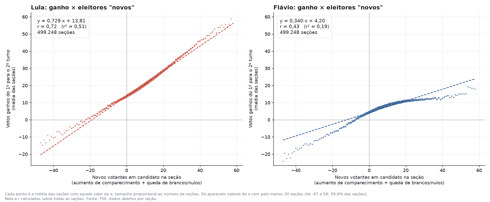

**Sem a parcela de Outros:** de cada seção sai a parcela que veio de outros candidatos, estimada pela fração Outros →
candidato da matriz do estado × votos em Outros na seção no 1º turno.

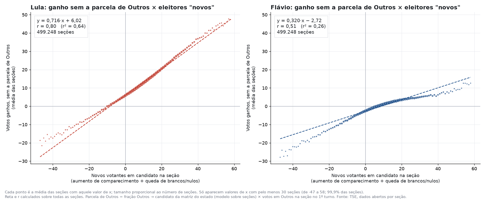

- **Inclinação:** cada eleitor novo rendeu em média cerca de 0,7 voto ao Lula e
  0,3 ao Flávio, com ou sem a parcela de Outros — a relação com os eleitores
  novos não vem da transferência de outros candidatos.
- **Intercepto:** numa seção sem eleitores novos, tirada a parcela de Outros, o Lula ainda ganha cerca de
  6 votos e o Flávio perde cerca de 3
  (perdas para abstenção, brancos e nulos e trocas entre os dois).
- **Conferência sem a matriz:** a regressão múltipla ganho ~ x + votos em Outros dá
  0,69·x + 0,50·Outros para o
  Lula e 0,31·x + 0,50·Outros
  para o Flávio. As inclinações em x batem. Os coeficientes de Outros somam 1 por construção (os ganhos dos dois somam
  x + Outros), por isso não são comparáveis às frações da matriz.

### Teste: o achatamento do Flávio é geográfico?

Nos gráficos acima, o ganho do Flávio para de crescer a partir de uns 15 eleitores novos. Para testar se isso é um
"teto" ou efeito de mistura de lugares diferentes, as seções foram divididas em cinco faixas de força do Flávio no
1º turno (% do eleitorado), e cada faixa ganhou sua própria curva; e foi estimada uma curva livre (uma indicadora
para cada valor de x) com efeito fixo de estado e força de Lula e Flávio no 1º turno.

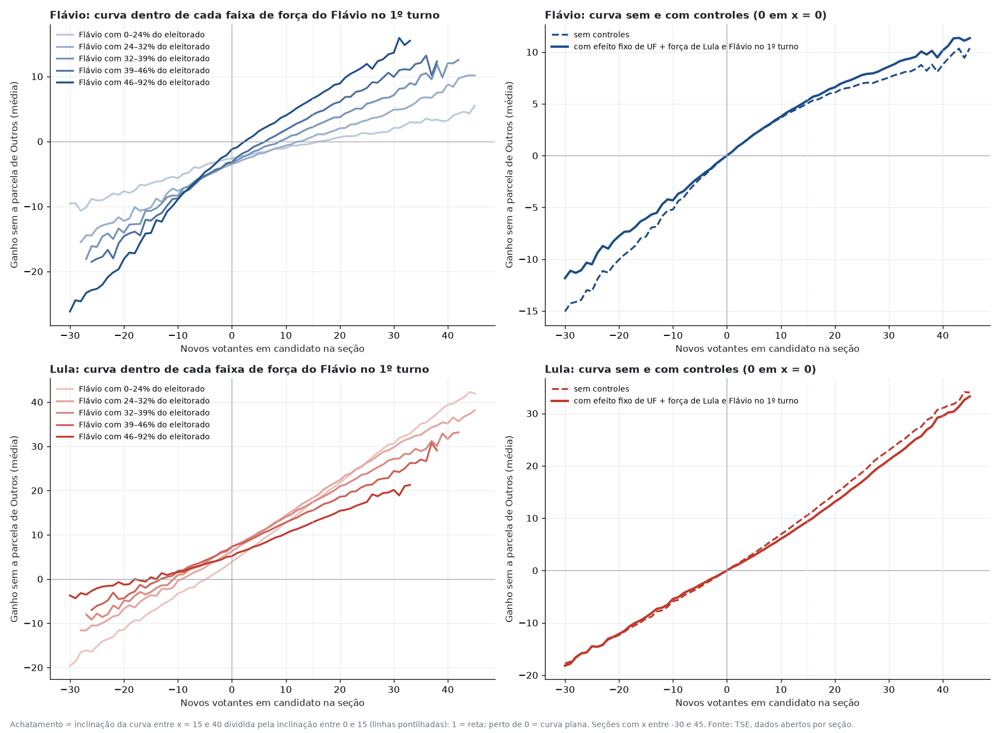

| Força do Flávio no 1º turno | Seções | Eleitores novos (média) | Seções com x ≥ 20 | Inclinação Flávio | Inclinação Lula | Votos Flávio | Votos Lula |
|---|---:|---:|---:|---:|---:|---:|---:|
| 0–24% | 99.241 | 11,1 | 23% | 0,17 | 0,87 | -91 mil | 1,38 mi |
| 24–32% | 99.254 | 12,1 | 23% | 0,29 | 0,77 | -21 mil | 1,59 mi |
| 32–39% | 99.237 | 10,4 | 16% | 0,38 | 0,67 | 48 mil | 1,41 mi |
| 39–46% | 99.241 | 8,4 | 10% | 0,48 | 0,56 | 89 mil | 1,17 mi |
| 46–92% | 99.228 | 6,1 | 5% | 0,59 | 0,46 | 0,17 mi | 0,84 mi |
| **Total** | 496.201 | | | | | **0,19 mi** | **6,39 mi** |

Votos = ganho sem a parcela de Outros somado nas seções da faixa (a integral da curva ponderada pelo número de seções).

- **Dentro de cada faixa a curva é quase reta.** O achatamento (inclinação entre x = 15 e 40 dividida pela de 0 a 15;
  1 = reta) fica entre 0,89 e 1,14 nas 3 faixas com dados suficientes até
  x = 40, contra 0,44 na curva nacional.
- **A inclinação do Flávio cresce com a força dele no lugar,** de 0,17 a
  0,59; a do Lula cai de 0,87 a
  0,46. Com interação, a inclinação do Flávio é
  -0,022 + 0,0106 × força do Flávio (%).
- **Houve mais eleitores novos onde o Flávio era fraco:** seções com 20 ou mais eleitores novos são
  5 vezes mais comuns na faixa mais fraca dele do que
  na mais forte. Nos x altos a média nacional é dominada por esses lugares, e a curva achata.
- **Os controles aditivos não removem o achatamento** (0,54), porque só deslocam a curva
  — o que muda entre os lugares é a inclinação.
- **Integrais das curvas relativas a x = 0** (votos associados aos eleitores novos): Lula
  3,46 mi sem controles e 3,08 mi com controles; Flávio
  1,47 mi e 1,61 mi. Somados, ficam perto do total de
  eleitores novos nessas seções.

**Conclusão do teste:** não há um teto do Flávio em cada lugar; o achatamento é efeito de mistura. Os eleitores novos
seguiram a inclinação política do lugar, e houve mais deles onde o Lula era forte.

## Conclusões e hipóteses

**Fatos (aritmética dos resultados oficiais):**

- Lula ganhou 10,38 mi; Flávio, 3,72 mi. Os outros candidatos tinham
  9,32 mi no 1º turno, então ao menos 4,78 mi
  do ganho somado vieram de quem não tinha votado em candidato no 1º turno.
- A diferença virou de 2,22 mi para o Flávio no 1º turno para 4,43 mi para o Lula no 2º.

**O que o modelo indica com boa confiança — decomposição da virada:**

| Origem | Modelo sobre seções | Modelo sobre municípios |
|---|---:|---:|
| Abstenção, brancos e nulos do 1º turno (Lula − Flávio) | 6,05 mi (6,95 mi − 0,90 mi) | 5,01 mi |
| Eleitores de outros candidatos (Lula − Flávio) | 0,40 mi | 1,56 mi |
| Perdas e trocas entre os dois | 0,16 mi | 24 mil |
| **Virada total (estimada)** | **6,61 mi** | **6,59 mi** |

- **A mobilização de quem não tinha votado em candidato decidiu a eleição** nos dois modelos. Mantidas as demais
  parcelas, sem ela o Flávio teria terminado 1,67 mi à frente (modelo sobre seções).
- Os eleitores de outros candidatos se dividiram quase ao meio, com forte padrão regional.
- As bases foram estáveis: cerca de 99% dos eleitores de cada candidato no 1º turno repetiram o voto.

**Hipóteses (plausíveis, não testadas):**

1. **Mobilização de comparecimento nos redutos do Lula** — o ganho extra veio onde o comparecimento mais subiu; o dado
   não diz se por campanha, rejeição ao adversário ou outro motivo.
2. **Parte dos nulos do 1º turno era voto "errado" do Lula** — com seis votos na urna, o nulo para presidente tende a
   ser maior onde o Lula é forte; com um voto só no 2º turno, esse eleitor teria acertado. Teste possível: comparar
   o nulo para presidente com o nulo para outros cargos na mesma seção.
3. **Os eleitores de outros candidatos seguiram a geografia, não o candidato** — a divisão acompanha a região.

A hipótese do "teto do Flávio" foi testada e descartada (ver o teste acima).

**O que não dá para concluir:** comportamento individual (é inferência ecológica), rotatividade (os fluxos são
líquidos) e causas.

## Estresse da regressão de eleitores novos

A regressão ganho ~ x + Outros (seção [Eleitores novos](#eleitores-novos)) foi refeita em várias especificações
(318 eleitores por seção em média; x médio 9,6, dos quais
5,9 de queda da abstenção e 3,6 de queda de brancos e nulos).
Pela identidade ganho do Lula + ganho do Flávio = x + Outros, os coeficientes das duas equações somam 1 e basta a do Lula.

| Especificação (Lula) | x | Outros | r² |
|---|---:|---:|---:|
| Base | 0,69 | 0,50 | 0,71 |
| Ponderada pelo eleitorado | 0,69 | 0,48 | 0,70 |
| Efeito fixo de estado | 0,70 | 0,60 | 0,70 |
| + força de Lula e Flávio no 1º turno | 0,65 | 0,54 | 0,75 |

- **Queda de brancos e nulos × queda da abstenção:** separando x, a queda de brancos e nulos rende
  0,94 voto ao Lula (0,89 com efeito fixo de estado); a queda
  da abstenção, 0,62 (0,65). Quem deixou de votar branco ou nulo
  foi quase todo para o Lula.
- **Intercepto = força local.** Com os votos do Lula no 1º turno como controle, o intercepto quase some e aparece
  +0,051 × votos do Lula no 1º turno; os do Flávio ficam com ≈ 0.
- **Por região:**

| Região | x → Lula | Outros → Lula | x médio por seção |
|---|---:|---:|---:|
| CO | 0,58 | 0,49 | 6,7 |
| N | 0,53 | 0,71 | -3,3 |
| NE | 0,79 | 0,69 | 10,9 |
| S | 0,66 | 0,50 | 9,5 |
| SE | 0,67 | 0,57 | 11,8 |

- **Outros separados por candidato:**

| Candidato do 1º turno | Fração para o Lula (efeito fixo de estado) |
|---|---:|
| Cury | 0,74 |
| Renan Santos | 0,60 |
| Caiado | 0,47 |
| Zema | -0,05 |
| Demais | 1,03 |

  Estes coeficientes embutem a parcela dos eleitores de cada candidato que foi para branco, nulo ou abstenção (que
  reduz x). O do Zema tem pouca precisão (poucos votos, concentrados em Minas).

### Coeficientes que dependem da força local

Os coeficientes de x e de Outros como função da força do Lula no 1º turno (p = votos do Lula ÷ eleitorado da seção):

| Forma | Eleitores novos | Outros | r² |
|---|---|---|---:|
| Coeficientes fixos | 0,694 | 0,499 | 0,710 |
| Linear a·(1 + b·p) | 0,409·(1 + 1,75·p) | 0,335·(1 + 2,54·p) | 0,764 |
| Logística 1/(1 + e^−(α+β·p)) | α = -0,61, β = 3,76 | α = -0,74, β = 3,76 | 0,767 |

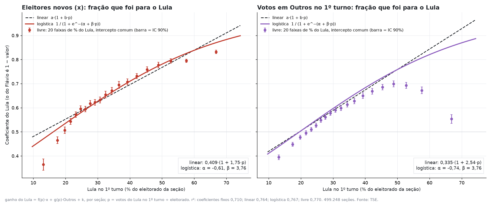

Os eleitores novos e os de Outros se dividiram conforme a força local do Lula, com a mesma sensibilidade (β ≈
3,8 nas duas variáveis). Na curva livre, a fração de Outros que foi para o Lula cai
nas seções onde ele é muito dominante — possivelmente porque ali quem votou em outro candidato tende a ser o eleitor
contrário a ele.

## Testes de integridade estatística

Estatística encontra anomalias, não fraude: cada teste abaixo foi desenhado para detectar um tipo de manipulação, e
os que podem ser calibrados foram calibrados injetando a fraude nos dados reais ou comparando com eleições anteriores.
Nenhum substitui as auditorias oficiais (boletins assinados, registro digital do voto, teste de integridade).

| Teste | O que detectaria | Resultado |
|---|---|---|
| Impressão digital (comparecimento × votação) | inserção de votos em seções específicas | sem cauda; 62 seções com comparecimento e voto no Lula ≥ 95% em 499.248 |
| Salto de comparecimento × vizinhas do mesmo local | adulteração localizada | 472 seções a 4+ desvios, nos dois sentidos; efeito líquido de 16 votos na diferença |
| Resíduos por modelo de urna, no mesmo local | urna de um modelo com resultado diferente | diferenças ≤ 0,17 voto por seção |
| Votos fixos por urna | conversão de K votos por urna | c = 0,26 ± 0,10 (com 10 injetados: 8,9); máximo compatível 0,43 voto por urna |
| Logs de urna: biometria (amostra) | votos sem eleitor real | liberações sem biometria +1,30 por seção (com 1% inserido: +4,48); inserção máxima 0,47% do eleitorado |
| Benford 1BL e 2BL, calibrado | números fabricados | dentro da faixa de 2022 e do 1º turno de 2026 |
| Brancos e nulos × Poisson, por zona | números regulares demais | igual ao 2º turno de 2022 |
| Efeitos fixos por zona, contra 2022 | concentração em zonas | distribuições contínuas, sem zonas destoantes |

### Impressão digital, seções extremas e resíduos

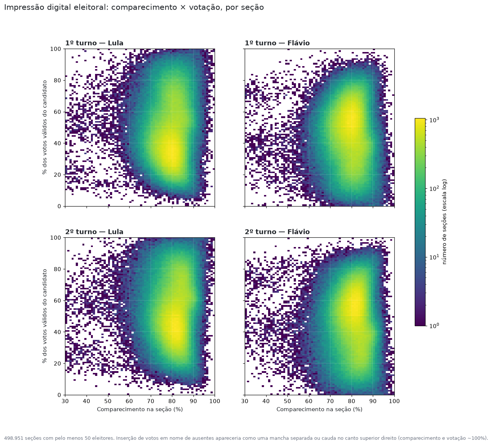

- **Impressão digital:** nuvens contínuas, sem mancha no canto de comparecimento e votação próximos de 100%; correlação
  entre comparecimento e votação de 0,05 (Lula) e
  -0,05 (Flávio) no 2º turno.
- **Comparecimento ≥ 95%:** 620 seções no 2º turno, pequenas (mediana de
  165 eleitores, contra 327), quase sempre a
  única do seu local; o comparecimento alto é do lugar inteiro.
- **Salto de comparecimento contra as vizinhas do mesmo local:** desvio típico de 1,9
  ponto; 8 seções a 6+ desvios acima e 21 abaixo (lista em
  `saida/forense_extremos.csv`).
- **Resíduos do modelo de transição:** média de 0,10 voto por seção na diferença Lula − Flávio;
  39% da variação fica entre locais de votação (geografia). Por modelo de urna, as
  diferenças brutas somem ao comparar seções do mesmo local. 1206 urnas trocadas entre os turnos
  não destoam (resíduo 0,09). 86 seções têm resultado que não saiu
  direto da urna.

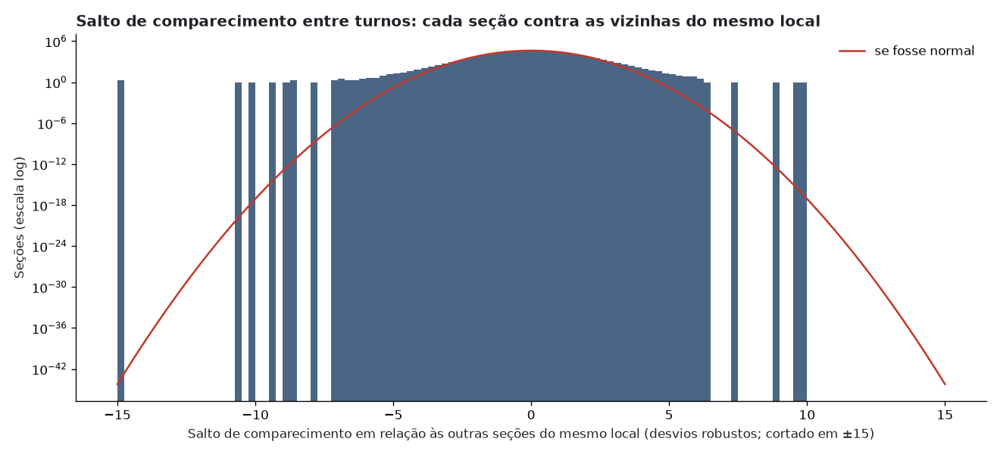
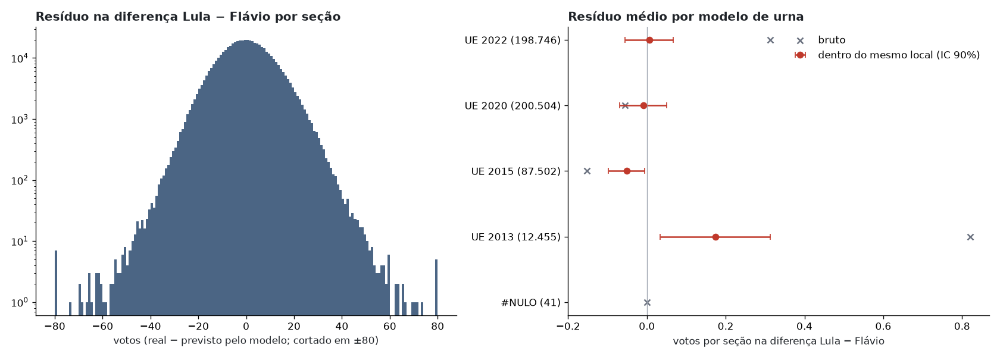

### Votos fixos por urna

Hipótese testada: 10 votos de brancos, nulos ou abstenção convertidos em votos no Lula em cada urna. Um número fixo
pesa mais nas seções pequenas; o teste compara seções de tamanhos diferentes no mesmo local de votação.

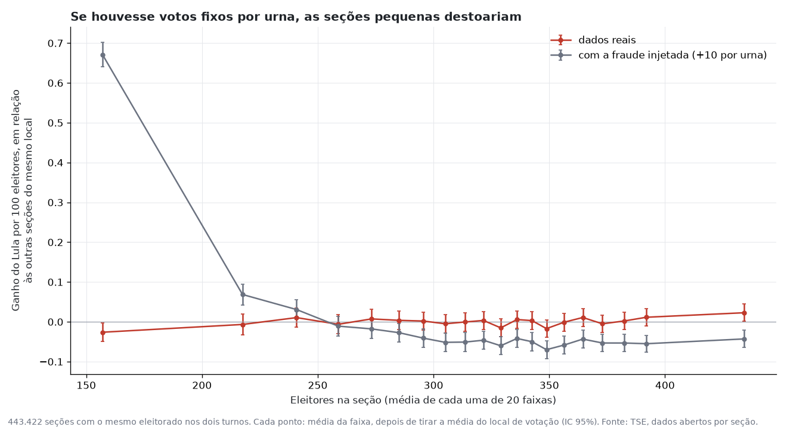

Nos dados reais, c = 0,26 ± 0,10 voto por urna no ganho do Lula e -0,72 na queda de
brancos, nulos e abstenção; com a fraude injetada, 8,9 e 8,0. Uma fraude
**proporcional** ao eleitorado não é distinguível por este teste.

### Logs de urna

Amostra de 3001 seções sorteadas por estado e 658
seções sinalizadas pelos testes acima; log e boletim dos dois turnos (`urna_amostra.py`, `urna_baixa.py`, `urna_log.py`).
Os arquivos de log não estão no repositório.

- **Biometria:** 12,20% dos eleitores liberados sem biometria no 1º turno e
  12,45% no 2º; variação de 1,30 ± 0,11 por seção. Uma
  inserção de 1% do eleitorado em votos sem eleitor real levaria a
  4,48; a inserção máxima compatível com os dados é de 0,47%
  do eleitorado.
- **Ritmo:** nenhum voto a menos de 10 segundos do anterior; o voto mais rápido no 2º turno vem da cédula com um só cargo.
- **Consistência:** em 18 seções o log tem menos votos que o boletim no 2º turno
  (provavelmente urnas substituídas durante o dia; só o log da urna totalizada foi baixado). Lista em
  `saida/urna_inconsistencias.csv`.

### Benford, calibrado

1BL nos totais por município (e por zona) e 2BL nas contagens por seção. Calibração: 2022 1º e 2º turnos (Lula e
Bolsonaro) e 2026 1º turno; teste: 2026 2º turno. Com 500 mil seções o qui-quadrado rejeita Benford em qualquer
eleição; o que importa é se o caso testado destoa da calibração.

| Teste | MAD na calibração | 2026 2º turno |
|---|---|---|
| 1BL município | 0,0033 a 0,0114 | Lula: 0,0036 (z = -0,9) |
| 1BL município | 0,0033 a 0,0114 | Flávio: 0,0116 (z = 1,1) |
| 1BL zona | 0,0121 a 0,0223 | Lula: 0,0129 (z = -0,7) |
| 1BL zona | 0,0121 a 0,0223 | Flávio: 0,0172 (z = 0,3) |
| 2BL seção | 0,0065 a 0,0131 | Lula: 0,0103 (z = 0,0) |
| 2BL seção | 0,0065 a 0,0131 | Flávio: 0,0091 (z = -0,5) |

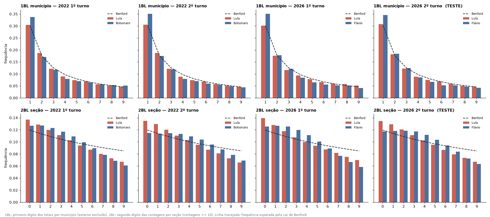

### Brancos e nulos × Poisson

Em cada zona, esperado por seção = taxa da zona × comparecimento; φ = X² / (n − 1) (1 = Poisson; < 1 = regular demais).

| Caso | φ mediano | Zonas com excesso de variação | Zonas com falta de variação |
|---|---:|---:|---:|
| Brancos 2022 2º turno | 1,085 | 25,1% | 1,3% |
| Brancos 2026 2º turno (teste) | 1,086 | 25,5% | 1,4% |
| Nulos 2022 2º turno | 1,266 | 62,4% | 0,5% |
| Nulos 2026 2º turno (teste) | 1,185 | 49,3% | 0,5% |

Sob Poisson puro, 5% das zonas apareceriam com falta de variação.

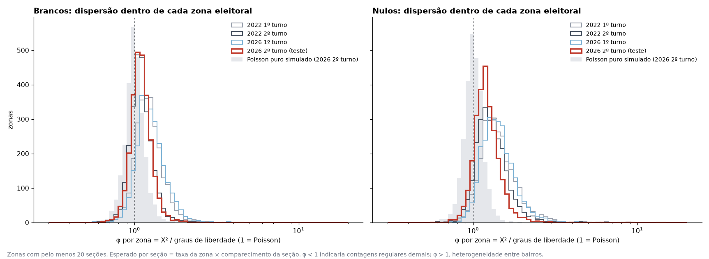

### Efeitos fixos por zona eleitoral, contra 2022

ΔVotos = efeito fixo da zona + β1·ΔComparecimento + β2·Queda de brancos + β3·Queda de nulos + β4·Outros 1T, por seção
(os β do adversário são 1 − β do Lula).

| β | Lula 2022 | Lula 2026 | Flávio 2026 |
|---|---:|---:|---:|
| β1 ΔComparecimento | 0,55 | 0,62 | 0,38 |
| β2 Queda de brancos | 0,46 | 0,82 | 0,18 |
| β3 Queda de nulos | 0,58 | 0,77 | 0,23 |
| β4 Outros no 1º turno | 0,46 | 0,59 | 0,41 |

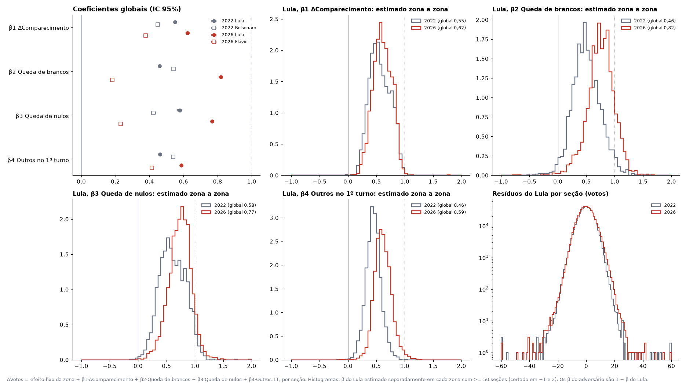

O Lula capta mais de cada fluxo em 2026 do que em 2022, sobretudo de brancos e nulos. Estimados zona a zona, os β têm
distribuição contínua, sem um grupo de zonas destoante; os resíduos de 2026 têm caudas até mais leves que os de 2022.

**Interceptos de zona** (votos do Lula por seção não explicados pelos quatro fluxos; mediana das zonas):

| Região | 2022 | 2026 |
|---|---:|---:|
| NE | -0,5 | 5,6 |
| N | -3,2 | 3,8 |
| SE | -4,0 | 2,7 |
| CO | -5,0 | 0,8 |
| S | -6,9 | -0,1 |

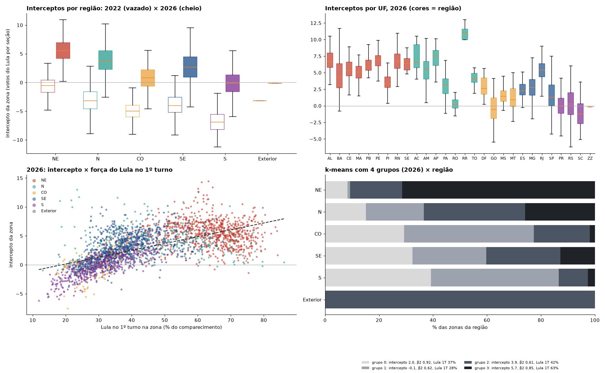

A distribuição inteira se deslocou a favor do Lula de 2022 para 2026, com a mesma ordem entre regiões; o intercepto
acompanha a força do Lula no 1º turno (r = 0,62). O agrupamento das zonas (k-means) não
encontra grupos naturais: as zonas variam de forma contínua, em faixas alinhadas à força do Lula. Roraima destoa (cerca
de +11 votos por seção): o comparecimento caiu entre os turnos e quem deixou de votar foi, em grande parte, eleitor do
Flávio — em 2026 ele perdeu votos em números absolutos em AC, AP, RR, AM, TO e MA, o que não aconteceu com Bolsonaro em
nenhum estado em 2022.

**O que estes testes não alcançam:** uma troca proporcional dentro do programa da urna (voto branco gravado como Lula,
sem eleitor a mais) seria indistinguível do comportamento real em todos os testes acima; ela é o objeto do teste de
integridade (votação paralela) e da auditoria do código, não de estatística sobre os dados publicados.


## Sensibilidade

Brasil, % da linha, variando o peso que puxa cada matriz estadual para a da região (lam, em observações médias;
0 = só os dados do estado; 100 ≈ matriz da região). O modelo principal usa 5.

**Sobre seções**

| Fluxo | por região | UF, lam=0 | UF, lam=2 | UF, lam=5 | UF, lam=20 | UF, lam=100 |
|---|---:|---:|---:|---:|---:|---:|
| Outros → Lula | 42,4% | 42,3% | 42,4% | 42,4% | 42,4% | 42,5% |
| Outros → Flávio | 40,2% | 38,1% | 38,1% | 38,1% | 38,0% | 37,9% |
| Brancos → Lula | 73,0% | 69,2% | 69,2% | 69,2% | 69,2% | 69,4% |
| Nulos → Lula | 61,6% | 59,6% | 59,6% | 59,6% | 59,6% | 59,6% |
| Abstenção → Lula | 8,9% | 9,5% | 9,5% | 9,5% | 9,5% | 9,4% |

**Sobre municípios**

| Fluxo | por região | UF, lam=0 | UF, lam=2 | UF, lam=5 | UF, lam=20 | UF, lam=100 |
|---|---:|---:|---:|---:|---:|---:|
| Outros → Lula | 48,5% | 53,2% | 53,3% | 52,6% | 50,8% | 49,3% |
| Outros → Flávio | 40,3% | 35,6% | 35,2% | 35,8% | 37,5% | 39,1% |
| Brancos → Lula | 70,7% | 56,7% | 62,4% | 64,7% | 67,6% | 69,2% |
| Nulos → Lula | 63,0% | 56,2% | 57,2% | 58,4% | 60,6% | 61,9% |
| Abstenção → Lula | 6,9% | 7,7% | 6,9% | 6,7% | 6,7% | 6,8% |

## Qualidade do ajuste

R² dentro de cada estado (variação entre observações explicada pelo modelo), mediana entre os estados:

| Observações | Lula | Flávio | Brancos | Nulos | Abstenção |
|---|---:|---:|---:|---:|---:|
| seções | 0,94 | 0,96 | 0,17 | 0,23 | 0,77 |
| municípios | 0,98 | 0,99 | 0,53 | 0,63 | 0,83 |

O R² sobre seções é menor porque cada seção tem poucos votos brancos e nulos, e o ruído de contagem pesa; isso
não indica modelo pior. Lula e Flávio são muito bem explicados nos dois níveis.

## Ressalvas

- **Inferência ecológica.** O modelo infere comportamento individual a partir de totais por seção. Ele vê, por
  exemplo, que o Lula cresceu mais onde havia mais brancos e nulos no 1º turno e atribui esse ganho a esses
  eleitores. Parte disso pode ser efeito de lugar: no 1º turno havia seis votos na mesma urna, e o voto branco ou
  nulo para presidente costuma ser maior onde o Lula já é forte.
- **Fluxos líquidos.** "0% do Lula para o Flávio" significa que as trocas diretas entre os dois se compensaram,
  não que ninguém trocou.
- **O intervalo de 90% mede só a incerteza de amostra,** não o erro que vem da hipótese do modelo, que é maior.

## Como reproduzir

Requer Python 3.11+ e as bibliotecas de `requirements.txt`. Os dados brutos não estão no repositório: os scripts
baixam da fonte oficial (cerca de 95 MB do site de resultados e 476 MB dos dados abertos).

```
pip install -r requirements.txt
python -X utf8 -E -P transicao.py saida/ 200                    # baixa os dados por município; modelo por região
python -X utf8 -E -P transicao_uf.py saida/ 200 5 municipio     # modelo por estado sobre municípios
python -X utf8 -E -P secao_base.py                              # baixa os dados por seção e monta a base
python -X utf8 -E -P transicao_uf.py saida/ 200 5 secao         # modelo principal
python -X utf8 -E -P grafico_fluxos.py saida/ secao             # diagrama de fluxos (também: municipio)
python -X utf8 -E -P grafico_novos_votantes.py saida/ bruto      # ganho × eleitores novos
python -X utf8 -E -P grafico_novos_votantes.py saida/ sem_outros # idem, sem a parcela de Outros
python -X utf8 -E -P teste_teto_flavio.py saida/                # teste do achatamento do Flávio
python -X utf8 -E -P estresse_regressao.py saida/               # estresse da regressão de eleitores novos
python -X utf8 -E -P coef_por_forca.py saida/                   # coeficientes que dependem da força do Lula
python -X utf8 -E -P forense.py saida/                          # impressão digital, extremos, resíduos
python -X utf8 -E -P teste_fraude_constante.py saida/ 10        # votos fixos por urna (aqui, 10)
python -X utf8 -E -P urna_amostra.py                            # amostra de seções para os logs
python -X utf8 -E -P urna_baixa.py dados_urna/amostra.csv       # baixa log e boletim (~1 GB)
python -X utf8 -E -P urna_log.py                                # lê os logs
python -X utf8 -E -P urna_analise.py 1                          # testes com os logs
python -X utf8 -E -P base_votacao.py 2022                       # base por seção de 2022 (baixa ~270 MB)
python -X utf8 -E -P base_votacao.py 2026                       # mesma montagem para 2026
python -X utf8 -E -P benford.py saida/                          # Benford calibrado
python -X utf8 -E -P poisson_brancos_nulos.py saida/            # brancos e nulos × Poisson
python -X utf8 -E -P fe_modelo.py saida/                        # efeitos fixos por zona, 2022 e 2026
python -X utf8 -E -P fe_interceptos.py saida/                   # interceptos de zona
python -X utf8 -E -P gera_relatorio.py                          # este README
python -X utf8 -E -P validar.py                                 # confere os resultados
```

O bootstrap usa semente fixa, então os resultados se repetem exatamente. Para validar sem baixar nada, rode só
`validar.py`: ele usa as bases já montadas em `saida/` (`transicao_municipios.csv` e `transicao_secoes.csv.gz`),
refaz os ajustes e confere a coerência de todos os resultados publicados.

## Arquivos

| Arquivo | Conteúdo |
|---|---|
| `transicao.py` | baixa os resultados por município do site do TSE e estima o modelo por região |
| `transicao_uf.py` | modelo por estado (sobre municípios ou seções), agregado para o Brasil, e gráficos |
| `secao_base.py` | baixa os dados abertos por seção e monta a base dos dois turnos |
| `grafico_fluxos.py` | diagrama de fluxos entre os turnos a partir dos fluxos nacionais |
| `grafico_novos_votantes.py` | ganho de cada candidato × eleitores novos, por seção (`saida/novos_votantes*`) |
| `teste_teto_flavio.py` | teste do achatamento do Flávio por faixa de força e com controles (`saida/teste_teto_flavio*`) |
| `estresse_regressao.py`, `coef_por_forca.py` | estresse da regressão e coeficientes em função da força do Lula (`saida/estresse_regressao*`, `saida/coef_por_forca*`) |
| `forense.py`, `teste_fraude_constante.py` | impressão digital, seções extremas, resíduos por modelo de urna, votos fixos por urna (`saida/forense_*`, `saida/teste_fraude_constante*`) |
| `urna_amostra.py`, `urna_baixa.py`, `urna_log.py`, `urna_analise.py` | amostra, download, leitura e testes dos logs de urna (`saida/urna_*`) |
| `base_votacao.py`, `benford.py`, `poisson_brancos_nulos.py`, `fe_modelo.py`, `fe_interceptos.py` | bases de 2022 e 2026 e os testes calibrados (`saida/votacao_*`, `saida/benford*`, `saida/poisson_*`, `saida/fe_*`) |
| `relatorio_integridade.py` | seções do README sobre o estresse e os testes de integridade |
| `gera_relatorio.py` | gera este README a partir de `saida/` |
| `validar.py` | confere os resultados publicados |
| `saida/transicao_secoes.csv.gz`, `saida/transicao_municipios.csv` | bases por seção e por município |
| `saida/transicao_secao_*` | modelo principal: matrizes por estado, Brasil, origens agrupadas, fluxos, sensibilidade, R², gráficos (`transicao_secao_origem_*.png` por origem, `transicao_secao_fluxos.png` diagrama de fluxos) |
| `saida/transicao_uf_*`, `saida/transicao_origem_*.png` | mesmo modelo sobre municípios (`transicao_uf_fluxos.png` diagrama de fluxos) |
| `saida/transicao.png`, `saida/transicao_fluxos.csv`, `saida/transicao_por_regiao.csv` | modelo por região |
| `saida/*_log.txt` | saída completa de cada etapa |

## Licença

Código sob licença MIT (ver `LICENSE`). Os dados eleitorais são públicos, do Tribunal Superior Eleitoral.
